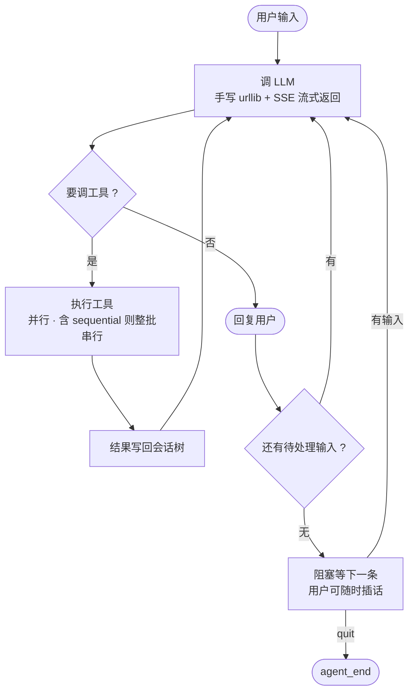
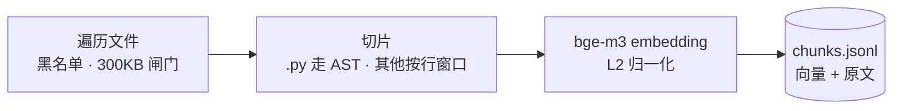
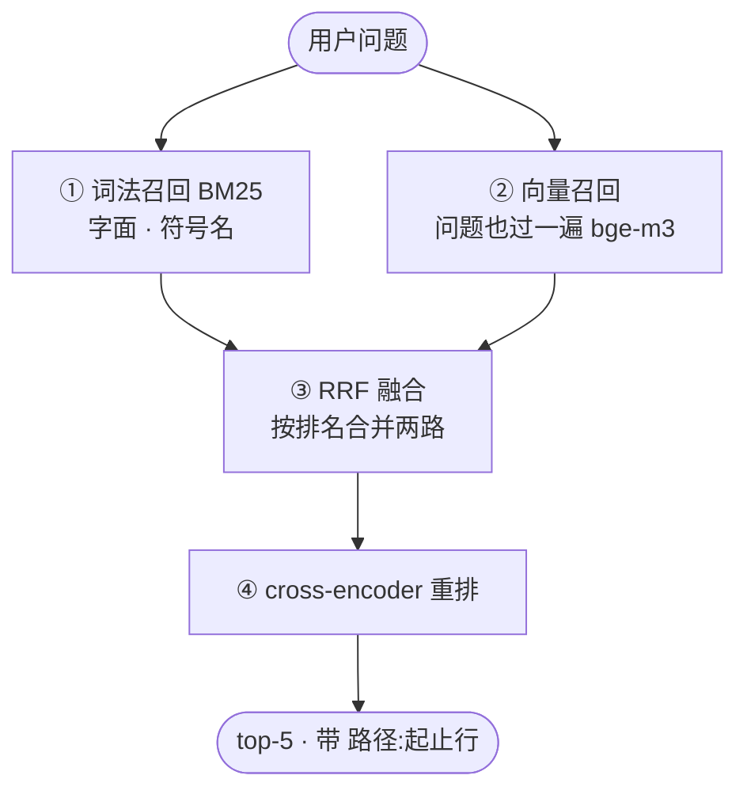

# pi —— 从零手写的 Agent 运行时

不依赖 LangChain / 任何 Agent SDK，标准库 + 5 个必要包手写实现：`urllib` 手写 SSE、
ThreadPoolExecutor 工具并发、会话树（MySQL 持久化）、tiktoken 上下文压缩，
外加一套带评测闭环的代码库 RAG。

---

## 快速开始

```bash
uv sync

# ① 构建代码索引（需 Ollama：ollama serve + ollama pull bge-m3 qwen3:4b）
uv run python rag/build_index.py

# ② 装本地 cross-encoder（重排档用；不需要 llama.cpp / torch）
uv add onnxruntime-directml tokenizers     # 无 GPU 用 onnxruntime

# ③ 四档检索评测（需 Ollama；生成档用同一个本地模型，加 --gen 打开）
uv run python eval/run.py
uv run python eval/run.py --md eval/result.md
RAG_EVAL_GEN=1 uv run python eval/run.py --gen --workers 4

# ④ 真机 REPL（需 Ollama + MySQL）
uv run python main.py
```

> REPL 内指令：`/branch` 开分支 · `/main` 回主线 · `/back` 光标退一步（会话内）
> ｜ `/new <名>` · `/open <名>` · `/fork <名>` · `/list`（跨会话）

---

## Agent 调用原理

双层循环：外层管会话生命周期，内层跑工具轮次。退出靠两个哨位——
没有待处理用户消息、且上一轮没有工具调用。



上半圈 `APP → LLM` 是内层——工具轮次反复跑，直到模型不再要工具；
下半圈 `PEND / WAIT → LLM` 是外层——一轮结束就交还控制权，等下一条输入。

三个保护性守卫不在图上，但都在循环里：

| 守卫 | 位置 | 拦的是什么 |
|---|---|---|
| 协议守卫 | `loop.py:43` | 历史末尾已是 assistant 时再调模型，它会自己续写、把历史搞脏 |
| 轮次上限 | `loop.py:48` | 模型陷入「反复调同一个工具」死循环，打断并交还控制权 |
| 截断保护 | `loop.py:66` | `length` 截断时半截参数写文件比不写更糟，一律不执行、报错让它重发 |

---

## RAG 检索原理

### 索引构建



先 embedding 才入库——没有向量的话这就只是个文本切片文件。manifest 记 mtime，
只重建改动过的文件，旧向量直接复用。

### 检索链路



**为什么要两路**：词法路对 `executeToolCallsParallel`、`finish_reason` 这类字面符号
一击必中（靠 IDF），向量路对「我记得有个处理日志压缩的东西」这类描述最准。
两者错得不一样，融合后互相补位。

**为什么要重排**：召回只保证「可能相关」，重排才做真正的精判——把 20 条候选
重新打分，只把最好的 5 条交给模型。

**为什么按排名融合**：BM25 分数和余弦量纲完全不同，加不到一起；排名无量纲。

两个图外的细节：query 走的是和建库**同一个** bge-m3，换模型就必须全量重建；
词法路有个开关，纯中文查询下它只能命中注释里的 bigram，属于噪声，所以默认
只在 query 含稀有标识符时才让它发言（实测等权融合 recall@5 0.708 < 纯向量 0.792）。

---

## 目录结构

```
main.py            REPL 入口 + Steering（后台线程读 stdin）
agent/
   llm.py          LLM 接入配置：model / base_url / api_key / timeout（本地 Ollama）
   loop.py         双层循环 + 工具调度（串行/并行/截断保护）
   protocol.py     数据契约 + stream_deepseek（手写 urllib + SSE）
   context.py      tiktoken 计数 → 超限 → 摘要压缩（MAX_TOKENS=8000）
   storage.py      会话树持久化：parent_id 成链 + lane 光标（MySQL）
tools/
   files.py        read_file / write_file（commonpath 路径沙箱）
   search.py       search_code（包装 rag/ 检索链路）
rag/
   chunker.py      AST 切片 + 行窗口兜底      config.py  阈值与开关
   embedder.py     Ollama bge-m3              store.py   BM25 / 余弦 / RRF
   retriever.py    两路召回 → 融合 → 重排     reranker.py  cross-encoder 双后端
   build_index.py  增量构建                   index/ 索引 · models/ 权重
eval/
   metrics.py      Recall@20 / MRR@5 / nDCG@5 / Context Recall·Precision
   generation.py   Faithfulness / Hallucination（论断级计数）
   adversarial.py  18 条对抗题（域外 10 / 近义 8）   run.py · result.md
```

---

## 技术点

1. **双层循环 + steering** — 内层跑工具轮次、外层管会话；deferred 暂存防止用户中途插话把 `tool_call` 和 `tool_result` 拆到两条分支。
2. **手写 SSE + 永不抛错** — 工具调用按 `index` 归位拼接；未知 `finish_reason` 映射成 `error`；任何异常都转成 error 事件 yield 出去。
3. **工具并行 + 保序 + 截断保护** — 提交顺序即收集顺序；批次里有 `sequential` 工具就整批串行。
4. **会话树** — `parent_id` 成链 + lane 当光标，LLM 读的永远是 `tree.for_path()`，回溯 / 开分支 / fork 只是移动指针。
5. **上下文压缩** — 超限时保留最近 5 条、更早的摘要进 system prompt，原始消息一条不丢。
6. **代码库 RAG** — AST 切片、代码专用分词、BM25 + 向量双路召回、加权 RRF 融合、cross-encoder 重排（onnx / llama-server 双后端，都没有则降级）。
7. **增量索引** — manifest 记 mtime，只重建改动文件并复用旧向量；已删除文件的 chunk 会被丢弃。
8. **路径沙箱** — `commonpath` 校验，拦住提示注入导致的越界读写。

---

## 评测结果

索引 208 chunk · 可解答集 39 条 · 对抗集 18 条（域外 10 / 近义 8）。召回池 20、交付 5。
生成与判官均用 deepseek-chat（T=0）——**这是切本地模型之前跑的旧数字**。

> ⚠️ 2026-10 起生成/判官已改成本地 qwen3:4b（见 `agent/llm.py`），**这三张表待重跑**。

### 检索质量

| 策略 | 档位 | Recall@20 | MRR@5 | nDCG@5 | p50_ms | p95_ms | errors |
|---|---|---|---|---|---|---|---|
| lexical | 单路基线 | 0.462 | 0.343 | 0.366 | 0.036 | 0.621 | 0 |
| vector | 单路基线 | 0.974 | 0.660 | 0.714 | 4.827 | 6.747 | 0 |
| hybrid | ② 混合 | 0.974 | 0.565 | 0.610 | 5.341 | 7.702 | 0 |
| hybrid_routed | ④ 无重排 | 0.974 | 0.677 | 0.727 | 5.213 | 7.101 | 0 |
| hybrid+rerank_noroute | ③ 重排 | 0.974 | 0.628 | 0.694 | 475.072 | 548.490 | 0 |
| hybrid+rerank+route | ④ 路由 | 0.974 | 0.628 | 0.694 | 471.445 | 553.650 | 0 |

> Recall@20 量召回池有没有 gold；MRR@5 / nDCG@5 量交付给模型的前 5 条排得好不好——
> 两段分开看才知道问题出在召回还是重排。
> p50/p95 只量检索本身（query 向量已预计算，不含 embedding 往返），只能横向比。

### 上下文质量

| 策略 | 档位 | Context Recall | Context Precision |
|---|---|---|---|
| lexical | 单路基线 | 0.410 | 0.345 |
| vector | 单路基线 | 0.833 | 0.662 |
| hybrid | ② 混合 | 0.705 | 0.569 |
| hybrid_routed | ④ 无重排 | 0.833 | 0.682 |
| hybrid+rerank_noroute | ③ 重排 | 0.846 | 0.629 |
| hybrid+rerank+route | ④ 路由 | 0.846 | 0.629 |

> 量交付给模型的那 5 条：相关 ⟺ 与 gold 标注行区间重叠。

### 生成可靠性

| 档位 | Faithfulness↑ | Hallucination↓ | 域外 | 近义 | 可解答 | 作答率 | 平均声明数 |
|---|---|---|---|---|---|---|---|
| ① 无上下文 | — | 0.000 | 0.000 | 0.000 | — | 0.000 | — |
| ② 混合 | 0.996 | 0.010 | 0.000 | 0.000 | 0.031 | 0.821 | 6.094 |
| ③ 重排 | 1.000 | 0.042 | 0.000 | 0.125 | 0.000 | 0.872 | 6.412 |
| ④ 路由 | 1.000 | 0.042 | 0.000 | 0.125 | 0.000 | 0.872 | 6.412 |

> Faithfulness = 能被上下文支持的论断占比（只在真正作答的样本上取均值）；
> Hallucination = 域外 / 近义 / 可解答三项的宏平均。
> ① 无上下文是不给检索结果的基线，prompt 要求「上下文不足就拒答」，所以通常全拒答（作答率 0）——
> 它幻觉率低是拒答的结果，读不出「没有 RAG 也安全」。

评测集：`eval/data/cases.jsonl`（39 条可解答）、`eval/adversarial.py`（18 条对抗）、`eval/cache/`（生成缓存）。
